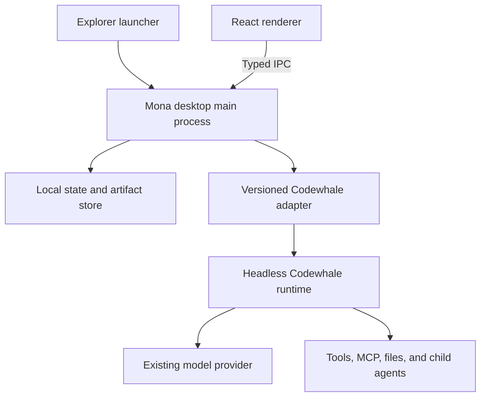
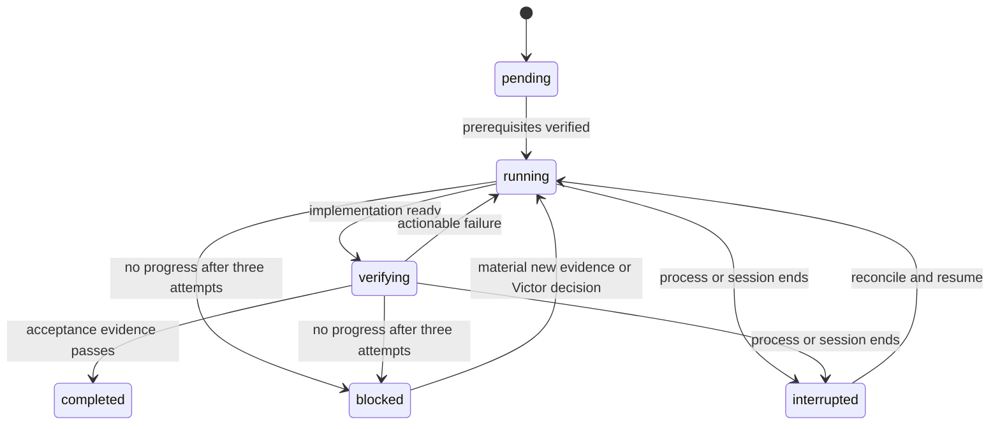

# Mona — Project specification

**Version:** 1.0 • **Prepared for:** Victor • **Architect:** Astra • **Research date:** November 11, 2026

**Status:** Implementation specification, not a claim that Mona exists or has passed compatibility tests.

**Companion:** `Mona_PROMPTS.md` contains the build sequence, acceptance gates, and session-resume instructions. Use **Mona** consistently; “Monda” in the original brief is treated as a typo.

## 1. The product

Mona is a beautiful, local desktop workbench for Codewhale: start a project from a folder, describe the outcome, watch meaningful work, inspect changes, and return tomorrow to exactly where you stopped. Codewhale remains the execution engine. Mona supplies the workspace, controls, continuity, and visibility.

The signature interaction is **right-click a folder → Start new DS project with Mona**. Mona opens that folder, starts Codewhale headlessly using Victor’s configured Full Access profile, and presents a ready-to-use workspace. Starting a project does not invent a task or spend tokens. The first model request occurs when Victor submits work or explicitly resumes an authorized queue.

The experience should feel like a bright creative studio with serious engineering underneath: welcoming at first launch, powerful during long jobs, quiet when nothing needs attention. A live project should be understandable in ten seconds: **what is happening, what changed, what it costs, and whether Victor is needed**.

### Non-negotiable product promises

1. **Preserve the economics.** No extra model layer, forced router, subscription, model-generated dashboard, automatic expensive fallback, or invisible background inference.
2. **Keep Codewhale in charge of agent execution.** Do not rebuild its provider client, tool loop, compaction, permissions, or orchestration.
3. **Show real state.** Disconnected is not stopped; interrupted is not completed; unknown cost is not zero; an untested feature is not supported.
4. **Resume from durable evidence.** Project state lives on disk, not only in a conversation or renderer memory.
5. **Respect the three-attempt rule.** After three attempts at the same problem without material progress, involve Victor. Continue genuinely independent work when possible. Do not conceal the failure behind a substitute implementation.
6. **Make beauty usable.** Strong hierarchy, excellent contrast, keyboard access, restrained motion, and useful density belong in the first release.
7. **Expose the whole supported engine.** Maintain a version-specific capability ledger; every discovered Codewhale feature gets a documented Mona surface or an explicit unresolved gap.

## 2. Feasibility and decision gates

### 2.1 What the research establishes

The upstream repository documents a local HTTP/SSE Runtime API for custom clients, a separate headless `exec` path, and a shared underlying engine. It also lists a bundled web interface and a desktop client in development. Codewhale is MIT licensed and supports direct provider billing with a user’s own key. These facts support building a frontend without an additional inference service. They do **not** prove the installed release has complete API parity, or that Codewhale is universally the cheapest harness. [S1–S3]

The current provider documentation recommends `deepseek-flash`; legacy V4 Flash names now resolve to a newer Flash model. Mona must preserve Victor’s actual working route and show requested versus resolved identity where available. It must not silently change his account, endpoint, model, or spend to match a documentation default. [S4]

The source pages track a changing `main` branch. Features in them may not be in a released binary. **Compatibility is established against the actual installed binary and its source tag/commit, not against this document’s research date.** No commands were executed on Victor’s machine for this specification.

### 2.2 Verdict

**Proceed with a small evidence-producing integration and cost prototype first.** There is no architectural reason for the visual layer itself to require extra model calls. Exact cost parity is a testable requirement, not an advance guarantee. The architecture below deliberately leaves provider traffic and model-context construction with Codewhale.

Three early gates precede substantial UI investment:

| Gate | Required evidence | Stop condition |
|---|---|---|
| G0 — Engine | One real tool-enabled task starts, streams, finishes, resumes, and can be interrupted through the selected local integration; effective Full Access and configured provider are verified | A mandatory behavior is unavailable in the installed release and cannot be corrected through its supported configuration or a documented compatible release |
| G1 — Economics | Equivalent direct and Mona-driven requests preserve provider/model/context settings; idle UI causes zero inference; benchmark quality and cost results are recorded | Mona introduces unavoidable model calls, loses material engine behavior, or materially worsens cost per accepted task |
| G2 — Surface coverage | Complete inventory of the pinned engine’s CLI, commands, API, configuration, extensions, and platform restrictions; every feature has an implementation route | A mandatory capability cannot be exposed without a replacement engine, fragile terminal scraping, or a new paid service |

If one gate blocks, checkpoint the findings and tell Victor precisely what must change. Work on independent documentation or fixture-based UI may continue, but do not call Mona feasible in full or complete the blocked gate. A newer engine release is an explicit, tested compatibility decision; do not silently upgrade Victor’s existing installation.

### 2.3 Why Mona should exist alongside upstream UI

Mona’s value is the combination of a polished Windows-first studio, folder launch, project-level memory, prompt-by-prompt execution, attempt tracking, clear cost attribution, and an accessible work review experience. Reassess upstream desktop progress at G0 and before release. Reuse supported protocols and libraries where suitable. Do not fork the entire engine to preserve a cosmetic distinction. If upstream now provides the same experience with lower maintenance, report that finding honestly before continuing unnecessary work.

## 3. Platform and technology decisions

### 3.1 Platform scope

- **First production target:** Windows 11 x64, native Codewhale, local NTFS workspaces. This follows the requested Explorer interaction and current Windows working context.
- **Separate later qualification:** Windows ARM64, macOS, Linux, WSL, UNC/network shares, and cloud-synced project directories. The application structure should remain portable, but none is advertised as supported until tested.
- **No WSL dependency in the Windows first release.** A WSL runtime is a distinct future adapter, with explicit path, process, and credential semantics.
- **Local desktop application:** no hosted service, required account, relay, mobile controller, or cloud database.

### 3.2 Chosen stack

| Concern | Decision | Reason |
|---|---|---|
| Desktop shell | Electron, current supported stable release pinned at implementation | One main TypeScript ecosystem; mature Windows desktop, process, installer, accessibility, and testing support |
| UI | React + TypeScript + Vite | Reusable view components, fast local work, familiar implementation patterns |
| Styles | CSS custom properties and CSS modules; accessible component primitives | Distinctive visual design without a heavy bespoke widget framework |
| Validation | One schema library shared across IPC and persisted types | Runtime validation at trust boundaries, fewer duplicated definitions |
| Storage | SQLite in a dedicated local service; filesystem artifacts | Transactional state, local search, deterministic recovery |
| Editor / diff | Monaco, loaded on demand | Strong text/diff tools; avoid loading it on the home screen |
| Terminal | xterm.js with a qualified native PTY binding | Explicit terminal workspace for advanced features; never the primary machine interface |
| Tests | Unit runner + Playwright/Electron integration + native Windows smoke scripts | Test contracts, user journeys, and Explorer integration at their actual boundaries |
| Packaging | Signed per-user Windows installer; small native Explorer command helper | Native folder integration and clean uninstall |

Select exact package versions during bootstrap, commit a lockfile, check license/maintenance and native-binary availability, and document the decision. Avoid simultaneously introducing competing UI, state, validation, or database frameworks. Electron memory is a real local resource cost, but it does not itself add API token charges. Measure its footprint. Do not switch to Tauri merely to chase a benchmark while abandoning completed work; a stack change requires a recorded problem and Victor’s decision if it changes this architecture.

## 4. The visual experience

### 4.1 Art direction: a luminous working studio

**Default theme, “Daybreak”:** warm pearl surfaces, inky text, violet primary controls, sea-glass success accents, and coral highlights. Brightness lives in intentional accents and project identity, not a wall of saturated panels.

**Second theme, “Afterglow”:** deep indigo surfaces, soft lilac text accents, vivid mint indicators, and warm amber attention states. Both themes must receive equal accessibility testing.

Starting palette, subject to measured contrast validation:

| Token | Daybreak | Use |
|---|---|---|
| Canvas | `#F7F8FC` | Main background |
| Surface | `#FFFFFF` | Cards and work areas |
| Ink | `#18213B` | Primary text |
| Muted ink | `#53617A` | Secondary text |
| Primary | `#6346DF` | Primary button, focus accents |
| Sea glass | `#007B70` | Confirmed success and healthy activity |
| Coral | `#D94A66` | Selective highlight, not arbitrary error text |
| Amber ink | `#8A5700` | Attention text on pale amber |
| Border | `#DCE2EF` | Layout separation; strengthen interactive borders as needed |

Use system UI typography with an optional bundled, permissively licensed display face. Do not fetch fonts from the internet at runtime. Body text approximately 14–16 px, generous line height, 8 px spacing rhythm, 12–16 px panel corners, and a consistent restrained shadow system. Dense and comfortable modes share the same information architecture.

Motion communicates state: 120–180 ms panel transitions, a subtle active-task pulse, no constant particle simulation, animated gradients, or fake typing. Respect reduced motion. A small abstract Mona mark can animate on meaningful transitions; decoration must be removable and consume no model tokens.

### 4.2 Main layout

- **Left rail:** projects, recent sessions, queue, search, settings. Collapsible but keyboard accessible.
- **Top context bar:** project and branch, actual runtime connection, effective model, Full Access status, spend, command palette.
- **Center studio:** conversation and work timeline, with a composer that supports file references, prompt templates, and explicit attachments.
- **Right inspector:** current task, requirements, agents, changes, or context. One inspector at a time; no permanent dashboard clutter.
- **Bottom drawer:** terminal, tests, engine logs, diagnostics. Closed until useful.
- **Persistent control strip during execution:** Pause after task, Interrupt now, and open blockers. Never hide these behind scrolling transcript content.

At 1280×800, the main task and composer remain usable without horizontal page scrolling. At 1920×1080, extra space reveals useful context rather than stretching text to unreadable widths. Support 200% scaling and screen readers. Treat terminal and code panes as separate scroll regions with an obvious keyboard escape path.

### 4.3 Views and meaningful empty states

| View | User-facing purpose | Required empty / failure state |
|---|---|---|
| Home | Resume a project, create one, see what needs attention | “Choose a folder to begin”; no API key demanded just to browse |
| Project studio | Talk, execute, and review in one place | Ready, connecting, offline, missing runtime, missing credentials are distinct |
| Work board | See prompt dependencies and verified progress | Unstarted tasks remain unstarted, not guessed percentages |
| Agent observatory | See parent/child work, ownership, status, spend | “No delegated work”; no decorative fake agents |
| Changes | Inspect evidence, diffs, tests, snapshots | “Changes unavailable” differs from “No changes” |
| Cost lens | Understand spending and optional limits | Missing price or usage is plainly labeled |
| Project memory | Review decisions, handoffs, blockers, unresolved work | Stale or conflicting state gets an actionable explanation |
| Capability explorer | Discover all features supported by this runtime | Unsupported or unqualified features explain the exact reason |
| Settings / Doctor | Configure routes, runtime, tools, privacy, recovery | Diagnostics give concrete next actions without exposing secrets |

Accessibility target: WCAG 2.2 AA where applicable to desktop web content, plus real keyboard and screen-reader checks. Do not advertise certified compliance based only on an automated scanner. Status uses text and icon as well as color. Announce meaningful status transitions, not every streamed token.

## 5. User journeys

### J1 — Start from Explorer

1. Victor right-clicks a folder or the background of an open folder and selects **Start new DS project with Mona**.
2. The native launcher passes the selected path as data to the single running Mona instance, or starts Mona.
3. Mona validates and resolves the folder, opens or registers the existing project, and selects the DS Full Access profile.
4. The project studio appears with the folder name, route, model, Full Access badge, and ready composer. A non-Git folder offers Git initialization without requiring it.
5. Victor enters a task. Mona submits it once to the headless engine and streams real progress.

No repeated Full Access confirmation for Victor’s established profile. First-run setup records the profile once. Full Access means Codewhale tool authority within the OS account’s rights; it does not bypass UAC, managed policy, missing credentials, or OS access controls. Mona remains a non-elevated desktop app during ordinary work.

Selecting an existing Mona project resumes its project view and offers a new session; it must not duplicate the project or blindly resume old execution. Selected files can gain **Open parent project in Mona** later; v1’s required shell actions are folder and folder-background launch.

### J2 — Assign a bounded prompt

Victor selects one prompt, sees its acceptance criteria and prerequisites, and starts it. The agent continues through implementation, relevant tests, documentation, and state updates. Ordinary plan completion is not a reason to stop. Completion is reported once the assigned prompt is verified. Queue mode is explicit; by default the next prompt waits for the next instruction.

### J3 — Return after a closed window or interrupted session

Closing the window minimizes to tray while work is running, using a recorded preference. Reopening reconnects to the same runtime and reconciles state. A full app or machine restart restores the last verified record and marks uncertain work interrupted/reconciling. It never silently replays a potentially executed tool operation. **Resume** means reconcile first, then continue the unfinished task.

### J4 — Understand and resolve a blocker

A blocker card shows the problem, three attempts, evidence, affected requirements, and the specific input Victor can provide. A nonblocking issue remains visible while independent tasks proceed. A blocking issue pauses its dependency chain. Acknowledging the card does not clear it or reset its attempt counter.

### J5 — Review and keep useful work

The completion view shows outcome, changed files, tests, actual or estimated spend, and residual limitations. Victor can inspect a diff, open an artifact, commit selected changes, or use a verified engine restore action. Restore is not advertised as reversing deployments, API writes, installed software, or every excluded/binary file.

## 6. Architecture and ownership



### 6.1 Boundaries

**Codewhale owns:** model requests, credentials it already manages, conversation/tool semantics, provider retry behavior, context compaction, execution permissions, tools, native child agents, native fleet/workflow execution, and its own sessions/receipts.

**Mona owns:** presentation, project catalog, durable prompt work board, user-authored handoff notes, feature mapping, process ownership, request reconciliation, independent UI state, local indexing, and normalized evidence projections.

**Mona must not:** call the provider directly for normal work, silently replay failed turns, rewrite Codewhale’s internal session database, simulate capabilities it cannot observe, or insert a second planning model above the engine.

### 6.2 Primary integration

Use the documented local HTTP Runtime API behind a versioned adapter. The documented entry point is `codewhale app-server --http`; exact authentication, workspace, permission, port, and feature controls must be read from the installed version’s help and matching source. A separate `exec` adapter is allowed only for verified one-shot jobs and diagnostics. It is not a silent substitute for a persistent control channel.

HTTP is a deliberate choice for broad runtime integration. Do not assume the similarly named stdio/ACP/private-socket interfaces expose equivalent operations. Test each transport’s actual abilities before selecting it. [S2]

Default to one owned runtime per active workspace, with one mutating turn per workspace. Validate upstream storage/process concurrency at G0 before enabling simultaneous runtime processes. A separate Codewhale home must not be invented to solve this: it may change credentials, configuration, sessions, and caching behavior. If safe parallel ownership cannot be demonstrated, serialize project execution and record that limitation until resolved.

Connect from Mona’s trusted local process, not the renderer. Bind only to loopback, use an unguessable runtime token supplied through the supported private mechanism, avoid secrets in command-line arguments, and verify endpoint identity. Never launch an unauthenticated runtime or bind to all network interfaces. Discover ports safely; verify the child’s identity, not just an HTTP 200 from an occupied port.

### 6.3 Mona’s proposed adapter interface

These names are **Mona contracts**, not claims about upstream route names:

```ts
interface EngineAdapter {
  discover(): Promise<EngineIdentityAndCapabilities>;
  startOwnedRuntime(input: RuntimeStart): Promise<RuntimeHandle>;
  getEffectiveProfile(input: ProfileRef): Promise<EffectiveProfile>;
  createOrOpenThread(input: ThreadRequest): Promise<ThreadRef>;
  submitTurn(input: TurnRequest): Promise<SubmissionReceipt>;
  reconcileSubmission(input: SubmissionRef): Promise<SubmissionStatus>;
  subscribe(input: SubscriptionRequest): AsyncIterable<EngineEvent>;
  interrupt(input: OwnedTurnRef): Promise<InterruptReceipt>;
  readHistory(input: HistoryQuery): Promise<HistoryPage>;
  readUsage(input: UsageQuery): Promise<UsageEvidence>;
  invokeCapability(input: CapabilityInvocation): Promise<CapabilityResult>;
  shutdownOwnedRuntime(input: RuntimeHandle): Promise<ShutdownReceipt>;
}
```

Each operation returns validated structured results and explicit capability failures. IDs remain opaque. Unknown events remain inspectable and must not crash the client. User-visible “supported” requires a passing contract test against the target binary, not merely a matching API field name.

### 6.4 Process lifecycle

- Track runtime executable path, version/hash, PID plus process creation identity, workspace, endpoint, ownership token, and startup receipt.
- Use a single-instance desktop owner. A second launcher invocation sends a path to the existing owner.
- The renderer can crash without killing a task. Closing to tray preserves work; **Quit and stop work** interrupts then shuts down owned children.
- On actual main-process failure, the initial target is clean child termination and recoverable interruption; persistent daemon survival is not a first-release guarantee.
- On Windows, qualify Job Objects or an equivalent tested owned-process mechanism for full descendant cleanup. Never kill all `codewhale`, `node`, or shell processes by name.
- A user-launched external runtime is read-only attach by default; do not claim ownership or shut it down. Driving it requires explicit adoption and compatible authority semantics.
- Sleep/network loss produces reconnecting state, not duplicate requests. Runtime crashes trigger bounded restart of the process only; resubmission is a separate reconciled decision.
- On an incompatible runtime update, preserve data and offer the last qualified binary selection. Do not update during active work.

## 7. Feature and requirement catalog

**Release tracks:** Foundation = feasibility/build infrastructure; Core = useful daily release; Complete = full pinned-engine coverage and production readiness; Later = explicitly excluded from 1.0. All Foundation, Core, and Complete requirements are mandatory for a “Mona 1.0 complete” claim.

| ID | Track | Function and required behavior |
|---|---|---|
| MONA-001 | Foundation | Discover installed Codewhale identity, path, matching source, and actual capabilities; record reproducible evidence |
| MONA-002 | Foundation | Prove tool-enabled Full Access headless execution, live events, interrupt, resume, and correct provider/model |
| MONA-003 | Foundation | Cost parity gate, zero idle inference, no hidden model or routing changes |
| MONA-004 | Core | Native folder and background launch, single-instance dispatch, safe path handling, idempotent registration |
| MONA-005 | Core | Project catalog: create, open, rename label, archive, pin, search, relocate, reveal folder; deleting catalog entries never deletes source |
| MONA-006 | Core | Bright accessible desktop shell; Daybreak/Afterglow themes, density, scale, reduced motion |
| MONA-007 | Core | Streaming conversation, drafts, attachments only when supported, file references, copy/export, search, code rendering |
| MONA-008 | Core | Explicit Plan/Work and effective permission display; Victor’s saved DS Full Access profile; no silent policy widening |
| MONA-009 | Core | Work board: prompt catalog, dependencies, acceptance criteria, deterministic eligible-task selection |
| MONA-010 | Core | Durable state, handoff, decisions, requirement traceability, attempt ledger, conflict detection |
| MONA-011 | Core | Three-attempt enforcement for Mona-managed jobs; honest visibility and cooperative instruction for engine-internal loops |
| MONA-012 | Core | Pause after task, interrupt now, queue cancel, resume, stop owned descendants; truthful partial/uncertain outcomes |
| MONA-013 | Core | Cost lens: usage, cache evidence, attribution, unknowns, budgets, export; no invented exact balance |
| MONA-014 | Core | Changes, tests, artifacts, receipts, provenance; virtualized diff and large-output handling |
| MONA-015 | Core | Git status/branch/worktree awareness, selected commits, non-Git operation, conflict-aware restore |
| MONA-016 | Core | Crash/reconnect recovery, duplicate event suppression, uncertain submission reconciliation |
| MONA-017 | Core | Deterministic activity digest, tray attention, quiet hours, completion/blocker notifications without inference |
| MONA-018 | Complete | Agent observatory: parent/child graph, task ownership, lifecycle, aggregate and individual spend when exposed |
| MONA-019 | Complete | Native goals, fleets, workflows, queue/runs and artifacts, using verified engine features without a competing scheduler |
| MONA-020 | Complete | Provider/model/profile selection, effective route visibility, reasoning settings, routing controls; Flash route locked by default |
| MONA-021 | Complete | MCP server, skill, plugin, hook, rule and instruction management through supported interfaces; health and provenance |
| MONA-022 | Complete | Command palette and capability explorer covering the entire pinned supported surface, including less common commands |
| MONA-023 | Complete | Integrated terminal and read-only advanced logs; explicit user-controlled terminal features when supported |
| MONA-024 | Complete | Local project memory/search, context-selection preview, prompt library/import/export and resume packet |
| MONA-025 | Complete | Settings backup/restore, migration, data retention, portable project handoff, diagnostics bundle and offline browsing |
| MONA-026 | Complete | Secure local boundary: renderer isolation, narrow IPC, runtime auth, redaction, path and Markdown safety |
| MONA-027 | Complete | Signed/reproducible installer workflow, modern Windows 11 menu integration, update compatibility, clean uninstall |
| MONA-028 | Complete | Automated and human QA, performance budgets, full feature matrix, release evidence, user/developer documentation |
| MONA-029 | Core | Model-free quick wins: Resume Brief, Focus Mode, evidence-linked completion cards, keyboard-first navigation |
| MONA-030 | Complete | No artificial feature hiding: honest unsupported states, version drift detection, upgrade qualification and coverage report |

### 7.1 Capability coverage process

The table above describes the product, not an assertion that every upstream capability is already known. During discovery produce `docs/codewhale-capabilities.json` and a readable coverage table. Inventory the pinned binary’s top-level/subcommand help, interactive help, configuration schema, matching API contract, tools, plugins, and platform features.

Each capability row contains: stable Mona ID; upstream name/source/version; platform; read/write/destructive classification; permission implications; cost implications; required arguments; chosen integration; UI location; tests; status; gap/issue if any.

Permitted integration labels:

1. **Native view:** purpose-built controls for common actions.
2. **Advanced action:** schema-validated command/configuration form, with effect preview and exact invocation.
3. **Integrated terminal:** a feature whose authentic interface is terminal interaction, intentionally exposed in Mona. This preserves access but does not satisfy a promised native GUI control.
4. **Unavailable on this platform/version:** visible explanation; no misleading enabled control.
5. **Blocked integration gap:** supported upstream but not faithfully surfaced in Mona; blocks full parity release until resolved or Victor explicitly narrows scope.

Do not treat a terminal button as blanket “all functionality exposed.” Every feature still needs its own row, working entry point, help, and verification. Do not inject arbitrary slash commands into the model prompt to simulate local commands; that can change cost and behavior. Unknown third-party plugin capabilities are discovered and bounded, not assumed safe or free.

## 8. Project execution and continuity

### 8.1 Two layers of state

Keep **building Mona** state distinct from **Mona managing another project**. The build uses `.mona/build/`; the product later manages project state under `.mona/project/`. Shared schemas/helpers are desirable, but the UI must not depend on a nonexistent app to bootstrap its own build.

Recommended repository layout:

```text
Mona_Project.md
Mona_PROMPTS.md
AGENTS.md
apps/desktop/
packages/contracts/
packages/engine-adapter/
packages/project-state/
packages/ui/
native/windows-shell/
tests/fixtures/
tests/integration/
docs/adr/
docs/evidence/
docs/codewhale-capabilities.json
docs/requirements.json
.mona/build/state.json
.mona/build/attempts.jsonl
.mona/build/HANDOFF.md
.mona/build/DECISIONS.md
.mona/build/BLOCKERS.md
```

`.mona/build` holds shareable, redacted status. Never commit keys, full private transcripts, local credential paths, or bulky raw logs. Machine-specific runtime bindings belong in local ignored state. A moved repository should retain task status without assuming a session ID exists on the new machine.

### 8.2 Task state machine



Also allow `skipped` only with Victor’s explicit scope decision, recorded against requirements. Unsupported or deferred is never silently converted into completed.

### 8.3 Minimal build state example

The builder initializes all prompt IDs from the companion file; this is a shape example, not a pre-completed ledger.

```json
{
  "schema_version": 1,
  "revision": 1,
  "project": "Mona",
  "spec_version": "1.0",
  "spec_sha256": null,
  "prompt_file_sha256": null,
  "current_prompt": "P00",
  "last_verified_commit": null,
  "tasks": {
    "P00": {
      "status": "pending",
      "requirements": ["MONA-001"],
      "completed_steps": [],
      "remaining_steps": [],
      "evidence": [],
      "blocker_ids": []
    }
  },
  "next_eligible_prompts": ["P00"],
  "last_checkpoint_utc": null
}
```

Use atomic replace, schema validation, a single writer, monotonic revision checks, and recovery copies. Do not overwrite an unread or concurrently changed state file. Track evidence by path/hash and relevant commit; when code changes invalidate evidence, move the affected requirement back to verification. Keep a short, human-readable handoff with current prompt, verified work, next exact step, unresolved attempts, and necessary file pointers.

### 8.4 The three-attempt rule, precisely

An **attempt** is one hypothesis-driven effort to resolve a particular problem, followed by an observed result. Re-running the same broken command after trivial edits, swapping a tool, changing an error string, or opening a new session does not create a new problem. Track a stable problem ID plus symptom fingerprint, affected requirement, attempts, results, and evidence.

**Material progress** means independently observable advancement: a failing reproduction narrowed to a specific component; a previously failing required test now passes; the root cause is isolated; or an external prerequisite is obtained. More code, a new theory, different wording, or “almost there” is not progress. Preserve total attempts and consecutive no-progress attempts separately. Reset the latter only with linked evidence and a short reason.

At the third consecutive no-progress attempt:

1. Stop trying that problem. Do not make a fourth disguised attempt.
2. Write the issue, three attempts, evidence, affected work, and exact help needed.
3. If independent eligible work exists, continue it and include the issue in the eventual report; keep the original requirement blocked.
4. If the assigned prompt or all eligible work is blocked, checkpoint and report to Victor immediately.
5. Do not remove a test, lower an acceptance criterion, substitute fake data, change platforms, or rearchitect the feature to make the blocker disappear.

Mona can enforce its own dispatch/retry counters. An engine-internal attempt may not be machine-observable; do not claim perfect semantic enforcement by parsing error text. Supply this rule in the project’s instruction file, collect structured agent attempt reports where available, and show the enforcement boundary. If native hooks/events can reliably stop an internal loop, qualify and use them. A model’s self-report is evidence of a report, not proof of actual test success.

### 8.5 Resume algorithm

Read repository instructions, then state and handoff. Verify working tree and current spec hashes. If a prior task says running, reconcile files, engine receipts, and evidence before changing status. Select the explicit human-assigned prompt; otherwise resume the unfinished current prompt; otherwise choose the earliest eligible prompt with verified prerequisites. Load only its relevant spec sections and source files. Finish that prompt, update requirements and handoff, and report. No full repository reread, giant transcript replay, or “what should I do next?” when the answer is already recorded.

## 9. Economics and DeepSeek-oriented execution

### 9.1 Zero inference UI overhead is the default

Navigation, search, titles, session list, status summaries, project colors, notifications, cost calculations, dependency evaluation, and resume briefs use local deterministic logic. Do not auto-summarize every turn with a model. User-requested AI summaries or reviews are explicit tasks with visible spend, not hidden convenience calls.

Keep provider endpoint, key source, model, tool configuration, engine compaction behavior, and reasoning controls unchanged in parity mode. No default auto-router; no fallback from Flash to Pro or another vendor. Provider errors surface as errors with the configured route intact. Preserve engine context ownership instead of inserting UI metadata, timestamps, changing dashboards, or entire planning files into every request.

Use stable instruction text and selective context. Provider caching is best-effort; prefix stability can help but cannot guarantee hits or identical bills. [S5] Codewhale remains responsible for provider-specific tool-call and reasoning history; Mona must not “optimize” those messages by stripping fields. [S6]

### 9.2 Build-agent operating style

These are engineering choices tailored to economical tool-driven work, not a claim of a special measured DeepSeek capability benchmark:

- Give one concrete deliverable per prompt, exact boundaries, relevant files, and observable acceptance checks.
- Use file search and targeted reads instead of repeatedly pasting the repository.
- Prefer shell/AST/test tools for facts; no extra model to explain command output already understood.
- Keep stable instruction prefixes. Read the large project document once during bootstrap and thereafter by relevant section and changed hash.
- Use structured short state updates, bounded outputs, focused diffs, and evidence paths.
- Use the configured thinking mode for implementation; increase effort only for a concrete hard problem and preserve the same model unless Victor changes it. Do not hard-code unsupported effort or sampling flags.
- One builder by default. Add a narrowly scoped child only when its separate work can materially help. Review and delegation consume tokens too; do not require a second model pass after every small change.
- Install only needed tool servers. Prefer existing local Git, ripgrep, test runners, compiler, and browser automation over redundant MCP servers. Enable MCP tools selectively and measure context overhead.
- No arbitrary context percentage trigger that replaces Codewhale’s compaction. Checkpoint to files before a necessary session handoff.

### 9.3 Cost calculation and presentation

Store source identity, timestamp, currency, provider, model, and rate revision. Historical estimates use the applicable historical rate. Provider-reported cost is labeled as such; locally calculated cost is an estimate; provider billing remains authoritative. Do not scrape account balances or claim an exact remaining prepaid balance without a supported interface.

Where the provider’s usage semantics make the buckets disjoint:

`estimated_cost = cache_hit_input × hit_rate + cache_miss_input × miss_rate + billed_output × output_rate + separately_billed_tools`

Normalize rate units, e.g. divide per-million rates by 1,000,000. Do not double-count reasoning tokens if they are included in output, or cached input if included in total input. Unknown buckets remain unknown. Parent totals and child totals must not both be counted as incremental charges. Use request/turn IDs and source semantics, never arrival order alone.

Optional budgets have session/project/day scopes and warn before the next dispatch. An in-flight provider request may complete after cancellation; a local spend limit is not a guaranteed invoice cap. If the engine lacks internal-call budget enforcement, Mona can block subsequent outer turns and request interruption, but must disclose this limitation. Do not add a mandatory small budget that interrupts Victor’s already authorized prompt midway; limits are user-set.

### 9.4 Benchmark protocol and gate

At P01, create a cheap fixture suite with a deterministic file change/test task, a diagnostic task, and a multi-step task. Run each through direct Codewhale and the minimal Mona adapter on clean equivalent workspaces. Same binary, provider, resolved model, settings, instructions, tool exposure, and task. Alternate execution order, record cache and pricing windows, and separate cold-start from warm-session observations. A tiny sentinel can establish connectivity; it cannot prove representative cost parity.

Collect accepted task result, requests, input/cache/output tokens, tool/API charges, elapsed time, retry counts, and effective configuration. Compare total cost **per accepted task**, not price per token alone. Use at least three paired repetitions per task where affordable; begin with one small pair and a predeclared $2 total pilot ceiling. This ceiling limits the benchmark, not normal project work. If actual rates or telemetry cannot support that ceiling, run recorded fixtures and mark live economics inconclusive until Victor supplies a ceiling or data.

Pass rules:

- Deterministic instrumentation/replay shows no Mona-induced inference, context mutation, tool duplication, or provider rerouting.
- Idle, navigation, exports, reconnects, notifications, and state refresh cause zero inference.
- Live tasks meet the same acceptance criteria. Treat a repeated median cost regression above 5% as investigation/hold; the 5% is a project tolerance, not a scientific guarantee.
- A small noisy sample without a causal regression is **provisional**, with figures and limitations; no marketing claim of exact cost equivalence. Failure to observe usage leaves cost unverified.

Re-run the gate after changes to adapter, context assembly, routing, orchestration, or engine versions. Ordinary style changes do not require another paid benchmark.

## 10. Data, events, recovery, and concurrency

### 10.1 Local data model

SQLite tables should cover `projects`, `runtime_bindings`, `threads`, `turns`, `submissions`, `tasks`, `task_dependencies`, `requirement_evidence`, `attempts`, `decisions`, `event_cursors`, `usage_records`, `capability_snapshots`, and `settings_versions`. Use foreign keys and migrations. Keep engine conversation history authoritative in Codewhale; store IDs and projections instead of a competing transcript authority.

Store large logs/artifacts outside the DB with digest, size, media type, source, and retention metadata. DB paths are local and access-controlled. No SQLite database on a network/cloud-sync directory. Use supported online backup APIs or quiesce every writer before backup/restore. A restore must stop the UI writer, worker/indexer, adapter ingestion, and task runner; no connection can bypass the maintenance lock. Never remove a recovery journal before a verified replacement is committed.

Project IDs are stable independently of path. Canonical path and filesystem identity detect aliases; drive-letter changes and moved folders require deliberate rebinding, not duplicating a project. Nested Git worktrees are distinct roots with an explicit shared-repository relationship.

### 10.2 Submission safety

Persist submission intent before transmission. Where the pinned runtime demonstrably supports idempotent operations and read-only lookup, use an opaque operation key and reconcile after response loss. Where it does not, do not retry a possibly accepted write automatically. Surface **Outcome unknown—reconcile required** with the observed thread/workspace evidence. Local journaling alone cannot guarantee exactly-once remote execution.

Deduplicate events using engine identity, thread/turn identity, and the documented cursor semantics. Do not assume numeric sequence IDs are contiguous or scoped a particular way. Persist accepted events/projections and cursor advances transactionally. Reconnect replays display state, never tool execution. Rate-limit reconnects with bounded backoff and stop on authentication/schema errors.

Maintain separate notions of transport-connected, runtime-alive, turn-active, and workspace-writing. Never infer completion from a disconnected stream or a quiet stdout pipe.

### 10.3 Concurrency and scheduler ownership

Default: one mutating run per workspace. Agent children use the native engine’s coordination, with ownership visible in Mona. Parallel Mona task execution requires isolated worktrees, separate branch ownership, aggregate budgets, a merge/review step, and native support. Do not let the Mona queue and a Codewhale goal/fleet both independently schedule the same task. Record one execution owner for every task.

Pause-after-task is a Mona queue boundary. Interrupt-now is an engine operation with a receipt. Cancel-queued removes future starts. These are distinct actions. Stopping a process cannot promise rollback of external side effects or already sent requests.

## 11. Full capability workbench

### Providers and models

Show configured routes, requested/effective model, reasoning controls supported by that route, connectivity status, and pricing freshness. Maintain Victor’s working Flash profile as the default. Engine credential management stays authoritative. A profile change affects only explicitly chosen scope: new threads, current thread when allowed, or project default. Display any difference between requested and effective values. Never write secrets into project files.

### Extensions

Give MCP servers, skills, plugins, hooks, and repository instructions clear scopes and provenance. Support inspect, enable/disable, supported install/remove, health, and effective configuration diff. Do not replace unknown configuration keys when editing known ones. Installation can execute code; show source and effects, follow Victor’s authorization, and use the engine’s own mechanisms. Advanced settings remain available through validated forms or a safe configuration editor when a specialized view would add little value.

### Agents and workflows

The observatory displays a compact expandable tree or task graph, not a decorative swarm: assigned work, workspace/branch, status, last meaningful event, tools, tests, and spend. Unknown child cost remains unknown. Native goals/fleets/workflows get their own launch and history surfaces where qualified. Interactive operation is not required to be free of all human input: tool logins, OS prompts, and unresolved decisions are shown as real waits.

### Terminal and command palette

The palette finds projects, prompts, actions, settings, and engine capabilities. It ranks locally. Advanced commands show their effect and cost class before invocation. The terminal supports copy, search, resize, reconnect rules, and explicit command entry; it has no access to the renderer’s broader IPC bridge. Terminal escape sequences and links cannot silently trigger privileged application actions.

### Source review and snapshots

Show staged/unstaged/user pre-existing work separately where evidence supports it. Do not attribute every workspace change to the agent. File editing uses fresh revisions and conflict detection; never overwrite an externally edited buffer. Before restore, show scope, excluded paths, and conflicts; create recovery evidence when supported. Avoid `reset --hard`, blanket clean, or overwriting Victor’s work as a routine troubleshooting method.

## 12. Delight that does not cost tokens

- **Resume Brief:** generated from task state: what finished, what failed, where work resumes, and what needs Victor.
- **Since you left:** deterministic grouping of real events, tests, and file changes. No extra summarizer.
- **Focus Mode:** one task, useful timeline, clear outcome, fewer panels. Advanced information stays one key away.
- **Evidence cards:** a completion claim links directly to the relevant test, diff, or artifact.
- **Cost lens:** per-task spend and cache data next to the outcome; unknowns are visually clear.
- **Project identities:** curated color/monogram combinations derived locally from project identity, editable by Victor.
- **Prompt shelf:** reusable prompts with variables and acceptance checklists; preview exactly what will be sent.
- **Calm notifications:** completion, blocker, and meaningful limit alerts only; quiet hours and deduplication.
- **Keyboard flow:** command palette, switch projects, focus composer, open changes, and navigate blockers without a mouse. Destructive/interrupt shortcuts require deliberate key combinations.
- **Health drawer:** plain-language diagnosis such as missing executable, incompatible version, or expired credentials, with safe next steps.
- **Portable handoff:** one redacted bundle of state, decisions, requirements, and file pointers; never a surprise upload of the repository.

## 13. Security and permission model

Full Access is an agent execution preference, not permission for untrusted UI content to gain arbitrary desktop control. The renderer stays sandboxed with context isolation and no Node integration. Expose named, schema-validated IPC operations; no general renderer `exec`, arbitrary filesystem API, or arbitrary URL fetch. Validate sender/frame and application origin. Use a restrictive CSP; remote content is never loaded into a privileged app window. [S7]

Escape model output, sanitize Markdown, disable executable raw HTML, constrain external links, and prevent file-link traversal. Treat repository documents, tool output, and imported prompt packs as untrusted content. Importing a prompt does not execute it. Local full-access agents can still damage user-accessible files; project labels and UI validation are not OS isolation.

Keep runtime tokens and keys out of renderer state, logs, crash dumps where controllable, URLs, screenshots, and exported diagnostics. Reuse the engine’s credential store; if Mona must store its own secret, use the OS credential facility. Diagnostics are local and redacted by default, with explicit export preview. No Mona telemetry by default. Show upstream telemetry settings separately and do not silently rewrite them.

Allow external HTTPS help links through the system browser after scheme/host validation. Local previews of generated applications must be isolated from the privileged Mona origin and have no desktop bridge. A future preview feature is not permission to give arbitrary localhost sites IPC access.

## 14. Explorer integration and installation

The v1.0 target includes the modern Windows 11 menu, not only “Show more options.” Microsoft documents the modern path through `IExplorerCommand` and app identity; this has packaging/signing implications that must be tested on the actual target system. A classic per-user context-menu registration is an early milestone, not an undocumented substitute. [S8]

Implement a minimal launcher/helper that only resolves selection and starts or signals Mona. Never run model work inside Explorer, block the shell on network calls, or concatenate selected paths into PowerShell/cmd script strings. The application CLI contract is Mona’s own proposed interface:

```text
Mona.exe project open --path <selected-folder> --profile ds-full-access
```

Use argument arrays/appropriate Windows quoting in launcher code; registry command templates must quote executable and folder placeholders correctly. Handle spaces, apostrophes, ampersands, parentheses, Unicode, trailing separators, duplicate launches, nonexistent paths, inaccessible folders, drive roots, and junction aliases. Broad roots require explicit project selection rather than recursively indexing a whole drive. Unqualified UNC/WSL paths explain the limitation.

Installer behavior: per-user by default; optional shell registration; preserve external Codewhale installation/config; install Mona-owned components only; verify release signatures/checksums through the chosen distribution mechanism; remove Mona-owned registration on uninstall; retain projects and engine history by default. Do not install root certificates or acquire signing credentials silently. Signing/distribution credentials may require Victor; create the unsigned test package and all independent evidence first, then record the exact remaining release prerequisite.

## 15. Quality targets and acceptance

Targets are engineering budgets to measure on the documented reference machine, not invented benchmark results:

| Area | Target / acceptance evidence |
|---|---|
| Startup | Warm project view interactive within 2 seconds; cold within 5 seconds excluding engine installation/startup and provider network |
| Renderer | Smooth typing and scrolling with a 10,000-event fixture; virtualized history, bounded memory |
| Idle | Zero inference; average app CPU below 1% over 60 seconds on reference machine; no unbounded timers |
| Memory | Initial idle total Mona processes target under 350 MiB; report engine separately and active editor/terminal increases |
| Shutdown | No orphaned Mona-owned descendants after normal quit; forced termination behavior tested |
| Recovery | Renderer crash, main crash, power-loss simulation, stream loss, response loss, duplicate replay, disk-full, migration failure tested |
| Cost | G1 evidence, unknown handling, no double counting, no hidden fallback |
| Accessibility | Automated checks plus keyboard, focus, scaling, reduced motion, and Windows screen-reader walkthrough |
| Shell integration | Fresh Windows user install → folder launch → second launch reuse → upgrade → uninstall |
| Feature parity | Every supported pinned-engine capability has a verified route; unresolved mandatory gaps block complete release |

Test high-risk boundaries: process ownership, submission replay, state writes, credential handling, path injection, budget math, concurrency, and restores. Avoid test volume for its own sake. Never fake an integration test using only a mock and describe it as real runtime compatibility.

Mandatory end-to-end scenarios:

1. New folder → Explorer → Mona → real file edit and passing test → evidence card.
2. Existing dirty repository opens without losing or committing unrelated work.
3. Close/reopen UI during work retains the same task and costs no extra inference.
4. Kill the renderer, then the app, then simulate machine interruption; reconcile accurately.
5. Lose a submission response; no duplicate task or false completion.
6. Three failed no-progress attempts block the issue; unrelated work remains eligible; restart preserves the count.
7. Provider failure never changes model/route or launches repeated expensive fallback requests.
8. Child agents/workflows show truthful lifecycle, ownership, changes, and usage boundaries.
9. Restore refuses conflicting or unsupported scope without destroying later user work.
10. Malicious output, path names, terminal links, and imported prompt packs cannot cross the UI privilege boundary.
11. Unknown runtime version disables unsafe unsupported operations while preserving offline project access.
12. Modern Windows menu, updates, and uninstall pass on a clean native Windows environment.

## 16. Scope discipline and release definitions

**Core usable release:** requirements marked Foundation/Core pass, with a clearly labeled capability coverage report. It may be useful for Victor before full parity, but must not be called “all functionality complete.”

**Mona 1.0 complete:** every Foundation/Core/Complete requirement passes, target Windows build is qualified, cost gate is accepted with stated confidence, no concealed integration gaps remain, and real UI review is complete.

**Later, not prerequisites:** mobile companion; remote execution/relay; team accounts; cloud sync; marketplace; background AI summaries; predictive task planning; multi-provider automatic optimizer; full IDE language server platform; custom model inference server; OS-wide assistant; macOS/Linux/ARM64/WSL support. These require new scope, not automatic execution after P23.

Publish an open-source-ready repository with license decision, third-party notices, contribution guide, security report instructions, compatibility policy, screenshots of actual builds, and reproducible build instructions. Public release, public repository creation, paid purchases, certificate acquisition, and accepting legal agreements are separate human-controlled steps. This specification authorizes building and local testing, not an unrequested public launch.

## 17. Definition of done for every implementation prompt

The assigned behavior works; relevant acceptance checks pass; affected requirement evidence is updated; new or changed decisions are recorded; open issues retain truthful status; no secrets are committed; current source and generated state agree; a local checkpoint commit exists when Git is available; and the handoff gives the next exact step. Remote pushes occur only to a confirmed authorized project remote under the repository’s rules. No invented repository destination.

Reports to Victor contain: completed prompt and outcome, validation, known blockers/limits, and next eligible prompt. Do not stop at a plan, ask permission for routine authorized installs, or expand into the next prompt without an explicit queue instruction. If a nonblocking issue forces independent work out of order, record that fact and preserve the unmet requirement.

## 18. Sources and evidence boundaries

The linked sources support the factual integration/platform observations. Mona’s architecture, feature requirements, UI, test gates, thresholds, and prompts are original proposed design decisions. All sources accessed November 11, 2026; reread matching version documentation during implementation.

- **S1 — Codewhale repository / README:** [Source](https://github.com/codewhale-hq/Codewhale) — engine/client availability, license and billing model. The README follows main, not necessarily the installed release.
- **S2 — Runtime integration contract:** [Source](https://github.com/codewhale-hq/Codewhale/blob/main/docs/RUNTIME_API.md) — primary custom-client entry point and transport distinctions. Verify every used operation against the pinned build.
- **S3 — Engine architecture:** [Source](https://github.com/codewhale-hq/Codewhale/blob/main/docs/ARCHITECTURE.md) — engine/client separation.
- **S4 — DeepSeek models and pricing:** [Source](https://api-docs.deepseek.com/quick_start/pricing/) — current model aliases and changing rate schedule. No hard-coded pricing promise is made here.
- **S5 — DeepSeek context caching:** [Source](https://api-docs.deepseek.com/guides/kv_cache/) — prefix-based, best-effort caching and usage fields.
- **S6 — DeepSeek thinking/tool behavior:** [Source](https://api-docs.deepseek.com/guides/thinking_mode/) — model-specific parameters and history requirements; engine must own these details.
- **S7 — Electron security guidance:** [Source](https://www.electronjs.org/docs/latest/tutorial/security) — isolation, sandbox, IPC, and content boundary guidance.
- **S8 — Microsoft Explorer integration:** [Source](https://learn.microsoft.com/en-us/windows/apps/desktop/modernize/integrate-packaged-app-with-file-explorer) — modern Windows menu/app identity integration.
- **S9 — Codewhale provider guide:** [Source](https://github.com/codewhale-hq/Codewhale/blob/main/docs/PROVIDERS.md) — resolve the actual configured provider route during discovery.

**Unverified until the builder tests locally:** Victor’s installed version, exact API feature coverage, native Windows behavior, actual provider pricing/account route, cost parity, process/storage concurrency, runtime ownership behavior, packaging/signing availability, and upstream desktop overlap. These are explicit work items, not hidden assumptions.
